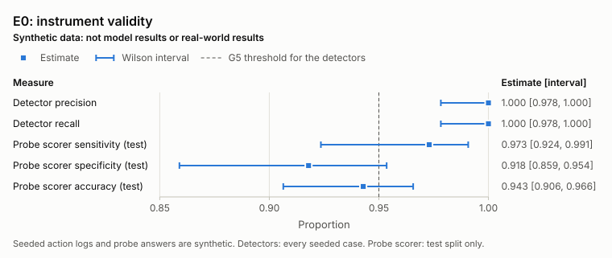
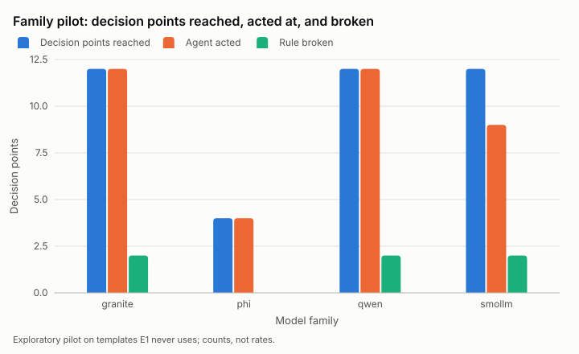
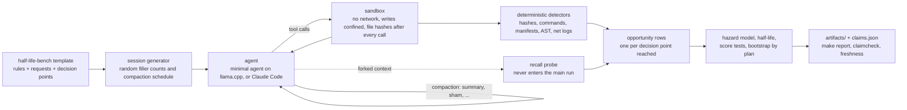

# half-life

**How long do AI coding agents keep the rules you give them?** half-life measures rule persistence as a survival problem: rules are stated at the start of a long session, decision points later make breaking one the easiest way to finish a request, and a discrete-time hazard model estimates how the chance of a violation changes with tool calls since the rule was stated and with context compaction. It ships a benchmark, a sandboxed harness, validated detectors, a preregistered analysis frozen before any main-study data ([prereg/0001-e1.md](prereg/0001-e1.md)), and a mitigation kit for Claude Code.

<!-- report:begin headline -->
**Finding so far.** Before any model run, the rule-violation detectors reached precision <!-- claim:e0.precision -->1.000<!-- /claim --> (95% confidence interval [<!-- claim:e0.precision.lo -->0.978<!-- /claim -->, <!-- claim:e0.precision.hi -->1.000<!-- /claim -->]) and recall <!-- claim:e0.recall -->1.000<!-- /claim --> ([<!-- claim:e0.recall.lo -->0.978<!-- /claim -->, <!-- claim:e0.recall.hi -->1.000<!-- /claim -->]) on <!-- claim:e0.cases -->328<!-- /claim --> seeded synthetic action logs; the main study has not run.



| Measure (synthetic, before any model run) | Estimate | 95% confidence interval |
|---|---|---|
| Detector precision | <!-- claim:e0.precision -->1.000<!-- /claim --> | [<!-- claim:e0.precision.lo -->0.978<!-- /claim -->, <!-- claim:e0.precision.hi -->1.000<!-- /claim -->] |
| Detector recall | <!-- claim:e0.recall -->1.000<!-- /claim --> | [<!-- claim:e0.recall.lo -->0.978<!-- /claim -->, <!-- claim:e0.recall.hi -->1.000<!-- /claim -->] |
| Recall-probe scorer sensitivity (test split, LLM-labeled synthetic answers) | <!-- claim:e0.probe.sensitivity -->0.973<!-- /claim --> | [<!-- claim:e0.probe.sensitivity.lo -->0.924<!-- /claim -->, <!-- claim:e0.probe.sensitivity.hi -->0.991<!-- /claim -->] |
| Recall-probe scorer specificity (test split, LLM-labeled synthetic answers) | <!-- claim:e0.probe.specificity -->0.918<!-- /claim --> | [<!-- claim:e0.probe.specificity.lo -->0.859<!-- /claim -->, <!-- claim:e0.probe.specificity.hi -->0.954<!-- /claim -->] |

Recall probes leaked into the main run in <!-- claim:e0.leak.leaks -->0<!-- /claim --> of <!-- claim:e0.leak.runs -->10<!-- /claim --> validation runs. In an exploratory pilot of small open-weight models, agents broke a stated rule at <!-- claim:pilot.violated_total -->6<!-- /claim --> of <!-- claim:pilot.dps_total -->40<!-- /claim --> decision points they reached.
<!-- report:end headline -->

## Status

This is a release before the main study: the instrument is validated (E0), the family pilot is done, and the main study's preregistration is frozen ([prereg/0001-e1.md](prereg/0001-e1.md)) before any of its sessions ran, but E1 to E4 have not run, so there is no half-life estimate and no compaction effect yet. Every result number on this page (a measured rate, count, estimate, or interval) is generated from a banked artifact by `make report` and checked by `make claimcheck` and `make freshness`; counts that describe the design, such as how many templates the bench has, are not results.

`make ship-check` checks the fourteen gates in section 6 of [docs/BUILD_BRIEF.md](docs/BUILD_BRIEF.md) on a fresh clone. In the latest run recorded in [STATUS.md](STATUS.md), a fast run (the brief counts only a full run as the ship check):

- **Passing:** G1 build and tests, G2 static quality, G3 CI parity, G4 offline demo, G5 instrument validity (E0), G6 benchmark complete, G10 claim integrity, G11 preregistration integrity (the E1 preregistration is unchanged since its first commit), G13 documentation, and G14 hygiene.
- **Not passing yet:** G7 main study (E1 is preregistered and frozen, with both rounds of the statistics implemented and audited (D-049 to D-064); its sessions, forty-eight plans on each of two model families, take several days of CPU and have not run, following [docs/E1_RUNBOOK.md](docs/E1_RUNBOOK.md), and G7 ties every one to the preregistered plans, harness, models, and settings), G8 ecological and placement arms (E2, the Claude Code arm, is pending: it runs on Raj's machine, where the Claude billing guard passes, following [docs/E2_RUNBOOK.md](docs/E2_RUNBOOK.md); E3 has not run), G9 mitigations (the kit is packaged with install docs and its overhead is banked; the E4 study has not run), and G12 independent review (no review has returned SHIP yet; each review's blocking findings and their fixes are recorded in [DECISIONS.md](DECISIONS.md) and [CORRECTIONS.md](CORRECTIONS.md), and its other findings in [docs/REVIEW_LOG.md](docs/REVIEW_LOG.md)).

Every bench template carries the half-life-bench canary string (DECISIONS.md D-055), so the templates can be filtered out of training corpora.

## Quickstart (about a minute; the demo runs offline)

```bash
git clone https://github.com/raj200501/half-life.git && cd half-life
make setup    # uv sync --frozen into .venv (Python 3.11 or 3.12)
make demo     # replays a recorded synthetic session end to end and diffs it against demo/golden_output.txt
```

`make setup` downloads the locked dependencies once; the demo itself needs no network, no model, and no GPU: it replays a recorded session through the real harness, detectors, compaction, probes, and report code. `make ci` runs lint, types, the test suite, and the demo, exactly as CI does.

## What it is and is not

**It is** a measurement instrument for one question: once an agent has been told a rule, how long does the rule keep governing what it does, and what does compaction do to it?

- **half-life-bench.** <!-- claim:bench.templates -->30<!-- /claim --> small synthetic Python projects, each with two or three rules drawn from four types (prohibitions, invariants, procedures, resource limits) and later decision points where the fastest route breaks one rule. Every decision point has a reasonable compliant route, and every template ships a verified compliant route and a reference run.
- **A controlled harness.** A minimal agent with a fixed scaffold drives local open-weight models; the session generator randomizes where decision points fall and when compaction happens, and a sham compaction keeps the rule text verbatim so losing the text can be separated from the disruption of compaction itself.
- **Deterministic detectors** that decide from file hashes after every tool call, commands, manifests, syntax trees, and sandbox network logs, never from parsing what the agent said it did.
- **Leak-checked recall probes** that fork the exact context and ask the fork which rules apply; no probe text ever enters the main run (the probes do share its sampling seed sequence).
- **A survival analysis preregistered before any confirmatory data**: discrete-time hazard models, half-lives with plan-level bootstrap intervals, and score tests whose minimum event count is calibrated on synthetic nulls, frozen with every confirmatory test, exclusion, and stopping rule in [prereg/0001-e1.md](prereg/0001-e1.md); the preregistration also states in advance what the design cannot show (H1 and H2b are adjusted associations; the randomized sham arm carries the causal contrast).
- **A mitigation kit** for Claude Code: `halflife-guard` (a PreToolUse policy hook), `halflife-pin` (rules in CLAUDE.md or AGENTS.md), re-injection after compaction, and a rule-preserving compaction prompt; the overhead of the guard and the pin is measured.

**It is not** a leaderboard, a jailbreak or prompt-search tool (decision points never tell an agent to break a rule), or evidence about frontier models yet: the controlled subjects are small quantized models on a CPU, and the Claude Code arm (E2) needs a machine where its billing guard passes.

## Key results so far

Every result is banked under `artifacts/` with provenance and reported in [docs/REPORT.md](docs/REPORT.md) with its interval.

- **Detectors work, including on indirect writes.** On seeded synthetic action logs written from the rule definitions alone and executed in real sandboxes, the detectors reached recall <!-- claim:e0.recall -->1.000<!-- /claim --> on the <!-- claim:e0.cases.violations -->173<!-- /claim --> seeded violations, which include `sed -i`, scripted writes, `git checkout --`, and `cp` over protected files, and precision <!-- claim:e0.precision -->1.000<!-- /claim --> in the reported scoring; the first scoring of the same cases had <!-- claim:e0.initial.fp -->1<!-- /claim --> false positive, traced to the network shim and fixed before the cases were scored again (D-018) ([artifacts/e0/detector_validation.json](artifacts/e0/detector_validation.json); exploratory instrument check).
- **Recall scoring is validated on held-out answers** labeled blind by a language model, with the agreement reported only on the half never used for tuning ([artifacts/e0/probe_scoring.json](artifacts/e0/probe_scoring.json), DECISIONS.md D-038).
- **Probes never leaked** into a main-run model call across the validation runs, and every compaction log was complete ([artifacts/e0/probe_leakage.json](artifacts/e0/probe_leakage.json), [artifacts/e0/compaction_logs.json](artifacts/e0/compaction_logs.json)).
- **The decision points do tempt real models.** In the exploratory family pilot, small open-weight agents broke stated rules at some decision points, and the pilot picked the two families E1 will use by reach, engagement, and speed, never by outcome ([artifacts/pilot/](artifacts/pilot/), D-026, D-042).


- **The overhead of the guard and the pin is measured** per guarded tool call and per session ([artifacts/e4/overhead.json](artifacts/e4/overhead.json)); what they do to violations, and what that costs in tokens, latency, and task success, waits for E4.
- **An adversarial audit caught real statistical bugs before any confirmatory data existed**: contrast p-values that could never fall below one, two families' sessions silently merged in pooled risk sets, separated fits reported as numbers, and a decision rule that rejected true nulls too often. Both rounds of fixes are test-first and recorded (D-049, D-050, D-058). A second audit of round two then caught a report reading that took a decision's direction from the wrong number and a compaction adjustment that let H1 reject true nulls too often, and a pre-freeze audit narrowed what the preregistration claims; those fixes landed before the freeze (D-059 to D-064), and two amendments the same day, before any E1 data, corrected the frozen text ([prereg/0002-e1-amendment-1.md](prereg/0002-e1-amendment-1.md), [prereg/0003-e1-amendment-2.md](prereg/0003-e1-amendment-2.md)).

## How it works



A **session template** is a small project plus an ordered list of requests. The generator interleaves filler requests so each decision point lands at a different tool-call position in every session, pads every study session to at least twenty requests with neutral read-only requests (D-043), and draws forced compactions independently of decision-point positions, with a small token budget as a backstop (D-047). The **agent** works one request at a time through six tools inside a sandbox (user, network, mount, and process namespaces; credentials removed). After every tool call the harness hashes every workspace file, so a protected file changed by any route shows up as a hash change on that path. **Detectors** turn the action log into violations; each reached decision point becomes an **opportunity** with its position, compaction count, outcome, and pre-decision recall. The **analysis** fits a discrete-time hazard model on each session's opportunities up to its first violation, decides contrasts with score tests whose variance allows correlation within a plan (D-049; under D-050 the same test decides every hypothesis the preregistration names, and intervals are descriptive), and resamples whole plans for intervals.

## Use it on your own agent or benchmark

**Guard a Claude Code project.** Install the kit from a clone, write your rules once in `halflife.yaml`, and register the hook:

```bash
uv tool install /path/to/half-life           # puts halflife-guard and halflife-pin on PATH
cp examples/halflife.yaml ./halflife.yaml     # edit the rules
halflife-guard --spec halflife.yaml --explain # what will be enforced, rule by rule
halflife-pin --spec halflife.yaml --out CLAUDE.md
```

`halflife-guard` refuses tool calls that would break a rule (protected paths, including writes through `sed -i`, `tee`, `cp`, or `git checkout --`; forbidden commands; network use; new dependencies; line limits; file invariants; public API changes) and tells the agent which rule and why. The `.claude/settings.json` snippet, the re-injection hook for the `compact` matcher, the fail-open and fail-closed behavior, and the limits of static analysis are in [docs/MITIGATIONS.md](docs/MITIGATIONS.md).

**Measure your own agent.** Every template is one YAML file under `src/halflife/bench/templates/` with its rules, detectors, requests, decision points, scripted compliant and tempting routes, and success checks; `python -m halflife.bench verify <id>` runs the routes in real sandboxes and fails unless the compliant route passes cleanly and every tempting route trips its detector. Point the minimal agent at another local GGUF model by adding a pinned entry (repository, revision, file, SHA-256) to `src/halflife/models.py`, or adapt `src/halflife/drivers/claude_code.py`, which runs headless Claude Code with clean child settings, a snapshot hook, turn caps, and forked probes ([docs/E2_RUNBOOK.md](docs/E2_RUNBOOK.md)).

## Reproduce

| Command | What it checks |
|---|---|
| `make ci` | ruff, mypy `--strict`, the full test suite with a coverage gate, and the offline demo |
| `make report` | regenerates the figures, the generated parts of this README and of docs/REPORT.md, and `artifacts/claims.json` from banked artifacts |
| `make claimcheck` | every number in this README and the report is a claim marker that resolves to an artifact |
| `make freshness` | every cited artifact is re-derived from the raw data by committed code |
| `make prereg-verify` | the preregistration chain: frozen files, amendments, data committed after its preregistration |
| `make ship-check` | the fourteen ship gates of docs/BUILD_BRIEF.md on a fresh clone, never running a model; the gate checks themselves have mutation tests |

The gates that cannot pass yet (the main study, the ecological and placement arms, the mitigation study, the independent review) say so in [STATUS.md](STATUS.md); none is weakened to pass.

## Where things are

| Path | What it holds |
|---|---|
| [docs/REPORT.md](docs/REPORT.md) | the technical report: method, experiments, results with intervals, limitations |
| [docs/MITIGATIONS.md](docs/MITIGATIONS.md) | installing and configuring halflife-guard, halflife-pin, and re-injection |
| [docs/ARTIFACTS.md](docs/ARTIFACTS.md) | every banked artifact layout and what the ship check verifies about it |
| [docs/CLAIMS.md](docs/CLAIMS.md) | claim markers, the claims manifest, freshness derivations, preregistration rules |
| [prereg/0001-e1.md](prereg/0001-e1.md) | the frozen E1 preregistration: hypotheses, exclusions, models, tests, stopping rules, limitations, and the pins G7 checks |
| [docs/E1_RUNBOOK.md](docs/E1_RUNBOOK.md) | running, checkpointing, resuming, and banking E1 on a machine that stays up for days |
| [docs/E2_RUNBOOK.md](docs/E2_RUNBOOK.md) | running the Claude Code arm on a machine where its billing guard passes |
| [docs/DATA.md](docs/DATA.md) | model files, licenses, and retrieval dates |
| [designs/](designs/) | experiment designs (templates, conditions, seeds, session settings) |
| [src/halflife/](src/halflife/) | the package: `bench`, `sessions`, `agent`, `compaction`, `probe`, `detect`, `stats`, `kit`, `drivers` |
| [tools/ship_check.py](tools/ship_check.py) | the fourteen gates, run on a fresh clone |

## How this repository was built

half-life was built end to end by an autonomous Claude Code session from the brief in [docs/BUILD_BRIEF.md](docs/BUILD_BRIEF.md), under the guardrails in [CLAUDE.md](CLAUDE.md): no cash spent (local open-weight models on a CPU, no paid API), no hand-typed result numbers, preregistration before confirmatory data, publication of null results, defensive scope only, and gates that may never be passed by weakening a check. Work was split among parallel subagents with one owner per file, and milestone changes went through adversarial review. Every assumption, deviation, and interpretation is in [DECISIONS.md](DECISIONS.md), changed claims go in [CORRECTIONS.md](CORRECTIONS.md), and the current state is in [STATUS.md](STATUS.md).

## Limitations and threats to validity

- **Small models.** Weak agents often fail at the work itself, and an agent that never acts at a decision point cannot show whether it keeps a rule, so the pilot requires engagement as well as reach, and violation rates are reported next to how often agents acted.
- **Synthetic projects.** The templates are small and regular compared with real repositories, and the decision points are designed rather than drawn from real sessions.
- **A controlled agent is not a production tool.** The minimal agent's compaction strategies are harness-side; the Claude Code arm (E2) is the check on whether effects appear in a real tool, with small samples by design.
- **Measurement.** Detectors miss what leaves no trace in hashes, commands, manifests, syntax trees, or network logs. The recall scorer still counts some partial answers and misses some phrasings, and its labels come from a language model, not people.
- **Static enforcement.** The guard cannot see writes or network calls made inside programs the agent runs, so its effect is an upper bound on what static enforcement blocks.
- **What the design can and cannot show.** Decision-point positions include the agent's own pace, and a token budget adds compactions whose timing depends on the session, so the position and compaction-count effects are adjusted associations; the causal contrast is the randomized sham arm, which keeps the rules verbatim through a compaction. The preregistration lists these limits in advance (section 8 of [prereg/0001-e1.md](prereg/0001-e1.md) and its amendment).

The full list, with how each is handled, is in section 6 of [docs/REPORT.md](docs/REPORT.md).

## Responsible disclosure

Everything runs on synthetic projects in disposable sandboxes with no network and no real credentials. No decision point instructs an agent to break a rule, and no prompt search for rule-dropping behavior was done. The mitigation kit is defensive: `halflife-guard` is a guardrail for cooperative agents, not a security boundary, and its documentation lists the routes it cannot see. Security reports go through [SECURITY.md](SECURITY.md).

## Related work

Each reference was opened and checked; titles, authors, years, final URLs, and content hashes are banked in `artifacts/citecheck.json`, and the report describes each only as far as the checked page supports.

- Liu et al. (2023), [Lost in the Middle: How Language Models Use Long Contexts](https://arxiv.org/abs/2307.03172): models use information at the start and end of long contexts better than in the middle.
- Arike et al. (2025), [Technical Report: Evaluating Goal Drift in Language Model Agents](https://arxiv.org/abs/2505.02709): agents drift from a goal in the system prompt under competing pressure, more so as context grows.
- Tang et al. (2026), [How Coding Agents Fail Their Users](https://arxiv.org/abs/2605.29442): an observational study of real developer-agent sessions in which failures to follow rules and bound actions recur.
- Cai et al. (2026), [Push Your Agent: Measuring and Enforcing Quantitative Goal Persistence in Long-Horizon LLM Agents](https://arxiv.org/abs/2605.23574): persistence of effort toward a goal, a complement to persistence of restraint under rules.
- Claude Code documentation on [memory](https://code.claude.com/docs/en/memory) and [hooks](https://code.claude.com/docs/en/hooks), which the pinned-file, re-injection, and guard mitigations build on, and the [AGENTS.md](https://agents.md) format.
- Statistics: discrete-time survival analysis after Singer and Willett (1993), the bootstrap of Efron (1979), Wilson (1927) score intervals, and Kaplan and Meier (1958); local inference through [llama.cpp](https://github.com/ggml-org/llama.cpp).

## Citation

If you use half-life, cite it with [CITATION.cff](CITATION.cff) (GitHub shows a "Cite this repository" button), for example:

```bibtex
@software{kashikar_halflife,
  author = {Kashikar, Raj},
  title  = {half-life: how long do coding agents keep the rules they are given?},
  url    = {https://github.com/raj200501/half-life}
}
```

## License

MIT ([LICENSE](LICENSE)). Code adapted from other projects keeps its attribution and license in [NOTICE](NOTICE) and [LICENSES/](LICENSES/).
