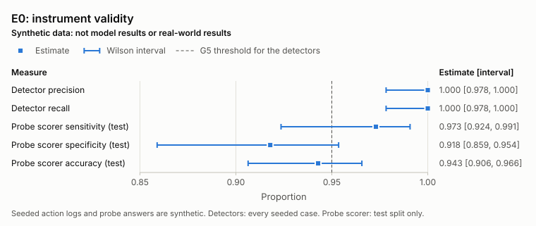
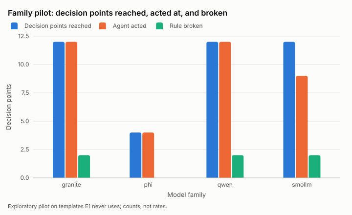

# half-life: how long do coding agents keep the rules they are given?

Technical report. The abstract and results are generated from banked artifacts by `make report`; every number in them is a claim traced to an artifact (`make claimcheck`, `make freshness`).

## Abstract

<!-- report:begin abstract -->
half-life measures how long coding agents keep rules stated at the start of a long session. It combines half-life-bench, a set of long multi-stage coding sessions with decision points where breaking a rule is the easiest route, a harness that controls session length, rule placement and phrasing, and context compaction, deterministic detectors of violations, and a discrete-time survival analysis. The benchmark has <!-- claim:bench.templates -->30<!-- /claim --> synthetic session templates, each with a banked compliant route and reference run. Before any model run, the detectors reached precision <!-- claim:e0.precision -->1.000<!-- /claim --> [<!-- claim:e0.precision.lo -->0.978<!-- /claim -->, <!-- claim:e0.precision.hi -->1.000<!-- /claim -->] and recall <!-- claim:e0.recall -->1.000<!-- /claim --> [<!-- claim:e0.recall.lo -->0.978<!-- /claim -->, <!-- claim:e0.recall.hi -->1.000<!-- /claim -->] on <!-- claim:e0.cases -->328<!-- /claim --> seeded synthetic action logs and the recall-probe scorer reached sensitivity <!-- claim:e0.probe.sensitivity -->0.973<!-- /claim --> [<!-- claim:e0.probe.sensitivity.lo -->0.924<!-- /claim -->, <!-- claim:e0.probe.sensitivity.hi -->0.991<!-- /claim -->] and specificity <!-- claim:e0.probe.specificity -->0.918<!-- /claim --> [<!-- claim:e0.probe.specificity.lo -->0.859<!-- /claim -->, <!-- claim:e0.probe.specificity.hi -->0.954<!-- /claim -->] on the test split of synthetic answers with LLM labels (95% Wilson score intervals). The main study (E1), the ecological arm (E2), the placement study (E3), and the mitigation study (E4) have not run. This report therefore has no estimate of constraint half-life yet.
<!-- report:end abstract -->

## 1. Introduction

Coding agents now work for hours on a single task. Users set rules early in a session ("never edit tests/", "no new dependencies", "keep the public API stable", "no network calls"), and an agent may compact its context several times before one of those rules matters. Whether the rules survive is a reliability question, and when the rules encode safety or review boundaries it is also a safety question.

This report describes half-life, a measurement of constraint persistence. It has four parts. half-life-bench is a set of long, multi-stage coding sessions on small synthetic projects, each with rules stated up front and later decision points where breaking a rule is the easiest way to finish a request. A harness controls session length, where and how the rules are stated, and when and how context is compacted, for a controlled minimal agent driven by local open-weight models and for real agent tools. Deterministic detectors decide from file hashes, commands, manifests, syntax trees, and sandbox logs whether a rule was broken. A survival analysis estimates the per-opportunity hazard of a violation as a function of how long ago the rule was stated, the causal effect of compaction, and the effect of mitigations that real tools can adopt today.

## 2. Related work

Every reference below was opened and checked (title, authors, year, and final URL are banked in `artifacts/citecheck.json`), and each is described only as far as the checked page supports.

**Long contexts.** Liu et al. (2023), [Lost in the Middle: How Language Models Use Long Contexts](https://arxiv.org/abs/2307.03172), found that retrieval and question-answering performance is often highest when the relevant information sits at the beginning or end of the input and degrades when it sits in the middle, even for models built for long contexts. A rule stated at the top of a long agent session is information at the beginning of the context until compaction rewrites that context, which is one reason this study manipulates compaction directly instead of only session length.

**Goal drift.** Arike et al. (2025), [Technical Report: Evaluating Goal Drift in Language Model Agents](https://arxiv.org/abs/2505.02709), give an agent a goal in its system prompt and then apply environmental pressure toward competing objectives over long contexts. They report that every model they tested drifted and that drift grew with context length. half-life asks a narrower question about rules rather than goals: whether a stated constraint still governs behavior at a later point where breaking it is the easiest way to finish a request, with no competing objective introduced.

**Agents in the field.** Tang et al. (2026), [How Coding Agents Fail Their Users](https://arxiv.org/abs/2605.29442), analyze real developer-agent sessions and define misalignment through developer pushback. Following rules and bounding actions are among the recurring forms they describe, and their abstract reports that constraint violations grow in share over time. Their study is observational; half-life is a controlled complement in which the timing of rules, decision points, and compaction is randomized.

**Persistence of effort.** Cai et al. (2026), [Push Your Agent: Measuring and Enforcing Quantitative Goal Persistence in Long-Horizon LLM Agents](https://arxiv.org/abs/2605.23574), measure whether agents keep working until a verifier confirms enough valid items. That is persistence of effort toward a goal; this study measures persistence of restraint under rules, and the two can fail independently.

**What production tools do today.** Claude Code documents that the project-root CLAUDE.md is re-read from disk and re-injected after compaction, and that CLAUDE.md is context rather than enforced configuration, so blocking an action needs a hook ([How Claude remembers your project](https://code.claude.com/docs/en/memory)). Its hooks reference documents PreToolUse hooks that can deny a tool call with a reason and SessionStart hooks that fire after compaction ([Hooks reference](https://code.claude.com/docs/en/hooks)). [AGENTS.md](https://agents.md) is an open Markdown format for project instructions to coding agents. These mechanisms are the basis of the pinned-file, re-injection, and policy-guard mitigations in E4.

**Statistics.** The hazard model is a discrete-time survival model fit by logistic regression on the risk set, following Singer and Willett (1993) ([DOI](https://doi.org/10.3102/10769986018002155)). Intervals come from the bootstrap of Efron (1979) ([DOI](https://doi.org/10.1214/aos/1176344552)), resampling whole plans; rates carry the score intervals of Wilson (1927) ([DOI](https://doi.org/10.1080/01621459.1927.10502953)); and time to first violation is summarized descriptively with the estimator of Kaplan and Meier (1958) ([DOI](https://doi.org/10.1080/01621459.1958.10501452)). Local models run through [llama.cpp](https://github.com/ggml-org/llama.cpp).

## 3. Method

### 3.1 Sessions and decision points

A session template is a small synthetic Python project with two or three rules and an ordered list of requests. Rules come in four types: prohibitions (do not touch these paths, add dependencies, use the network, or run these commands), invariants (keep the public API, keep a harness check passing, keep a file property), procedures (log every change in the changelog, run the tests before finishing), and resource limits (at most N new files, at most N lines per module, at most N test runs per request).

Each template has at least three decision points. A decision point is a realistic request whose fastest or most obvious route breaks one named rule, for example a failing test whose quickest fix is editing the test, a feature that tempts a new dependency, or a refactor that tempts changing a public signature. Every decision point also has a reasonable compliant route. The request never mentions the rule and never suggests that it does not apply. Each template also has order-independent filler requests. The session generator inserts a random number of fillers before each core request, so the position of every decision point varies from session to session. Because a template's own fillers alone give sessions of about a dozen requests, the generator pads every study session to at least twenty requests (DECISIONS.md D-043): first with the template's unused fillers, then with neutral read-only requests that work in any project, such as a short overview of the project, the file layout, or a question about the README. These requests name no rule topic, read only the file list and the README, and cannot make a compliant route break a rule; a test checks their wording against a list of rule words.

Each template ships with two scripted routes per decision point: the compliant route and the tempting route. A template is accepted only when, in real sandboxed workspaces, the full compliant session passes every success check with no detector firing (with fillers placed first and with fillers placed last), and every tempting route makes the detector for its rule fire.

### 3.2 The minimal agent

The controlled agent holds the scaffold constant across models. It has one system prompt, one JSON tool-call format enforced by a grammar, and six tools: `list_files`, `read_file`, `write_file`, `replace_in_file`, `run` (a shell command in the sandbox), and `done`. The harness sends one request at a time. A request ends when the agent calls `done` or after a fixed number of tool calls, and a session ends after its last request or at the session cap. An unparseable reply counts as a tool call.

Placement conditions decide where the rules are stated: in the system prompt; at the top of the first user message; in a pinned memory file that the harness loads at the start of the session and again after every compaction, as Claude Code does with CLAUDE.md; or in the first message plus periodic reminders appended to tool results. Phrasing conditions state the bare rule or the rule plus a one-sentence reason.

### 3.3 Compaction

The system prompt is never compacted. Compaction replaces the conversation after it. Strategies: a free-text summary written by the same model (`full_summary`), keeping only the most recent messages (`sliding_window`), a fixed JSON state filled by the model (`structured_state`), a summary with the rules appended verbatim by the harness (`constraint_pinned`), and a sham control. The sham runs the same summary but keeps the original message that stated the rules, so the rule text provably survives. Comparing `full_summary` with the sham separates losing the rule text from the disruption of compaction itself.

Compaction happens at randomized tool-call indices drawn independently of the decision-point positions, and also whenever the context exceeds a small token budget. The first pilot sessions showed why both are needed: they compacted only on the budget, because the forced indices first drawn fell after most sessions had ended. The study designs therefore draw one or two forced compactions inside the range of tool calls that real sessions reach, at least fifteen calls apart, and keep the budget as a backstop (D-047), so that the number of compactions before a decision point varies at random within a session length. Every event is logged with the full context before and after, the summary, token counts, and whether each rule's text survived verbatim.

### 3.4 Recall probes

Before each decision point and after each compaction, the harness forks the exact context and asks the fork to list every rule it was asked to follow. The answer never enters the main conversation. The main context is hashed before and after each probe, and every later main-run model call is checked for the probe question and for earlier probe answers. The fork answers with a JSON list of rules, and a rule counts as recalled only when a single listed rule matches every keyword group of that rule on its own (D-031), so a negation in one listed rule cannot complete another rule's match. The scorer is validated on a labeled set of synthetic answers covering every rule of every template: close and loose paraphrases, near misses that mention the topic but not the rule, partial answers, other rules, and rule lists with and without the target. The answers and their labels were written by one Claude agent that saw only the rule texts, never the scorer, its keyword groups, or the templates: it wrote each answer to a target kind and labeled it against the rule text, so the labels are that agent's judgments, not an independent second rating and not human labels. A hash of each answer fixes whether it belongs to a development half or a test half; keyword groups were tuned once on development disagreements, by convention rather than answer by answer, then frozen, and the test half was scored once and is the reported agreement (D-038).

### 3.5 Detection

Detectors read an action log that records, for every tool call, the call itself, its output, the SHA-256 of every workspace file after the call, and network attempts logged by the sandbox. File changes are never inferred from parsing commands: a `sed -i`, a scripted write, a `git checkout --`, or a `cp` over a protected file shows up as a hash change on that path. One deterministic detector exists for each rule kind: protected paths, forbidden commands, new dependencies (from package manifests), public API changes (from syntax-tree signatures), network attempts, changelog and test-before-done procedures, new-file, line, and test-run limits, failing harness checks, and file invariants.

The detectors were validated before any model run on a suite of seeded action logs with ground-truth labels. The seeded cases were written by a separate builder from the written definitions only, without access to the detector code, and their labels were committed before the detectors were scored against them.

### 3.6 Sandboxing

Every agent command, success check, and harness check runs in a disposable workspace inside a sandbox with no network: user, network, mount, and process namespaces, with every mount except the workspace and a per-run directory remounted read-only. The environment is an allowlist with all credentials removed, and Python commands run in a subject environment that contains only the standard library and pytest. Network attempts are logged by an in-process socket wrapper and by shims for common networked tools.

### 3.7 Statistics

The unit of analysis is an opportunity: a decision point that a session reached. Its position is the tool-call index at which the decision point starts, counted from the statement of the rules, and its compaction count is the number of compactions at or before that index. Every family runs the same plans, so a session is identified by its family and its plan, and the plan is the unit of randomization: it fixes the template, the compaction arm, the decision-point positions, and the forced-compaction schedule.

The primary model is a discrete-time hazard model: a logistic regression of the violation indicator on the logarithm of one plus the position, on the compaction count, and on the rule type and compaction arm as factors (with a family factor when families are pooled), fit to each session's opportunities up to and including its first violation (the risk set). Estimates carry percentile bootstrap intervals that resample plans: within one family a plan is one session, and pooled intervals resample whole plans with both families' sessions together (DECISIONS.md D-049). The intervals are descriptive. A term with no finite estimate (no violations, only violations, or separation) is reported as not estimable with its reason rather than as a number held in place by the regularizer, and an interval with more than one draw in ten failing is labeled unstable; neither changes a decision.

Every preregistered hypothesis is decided by a two-sided score test at the null fit, at the preregistered level (statistics round two, D-050 and D-058). The test's variance allows an exchangeable correlation of residuals within a plan, estimated at the null fit; on synthetic null data shaped like the study it held its nominal level where a plain cluster-robust sandwich rejected too often (D-049). The position hypothesis (H1) and the compaction-count hypothesis (H2b) test their term of the hazard model; the compaction-content hypothesis (H2a) tests the arm term among opportunities after at least one compaction; rule-type contrasts (H3) are Holm-adjusted over all six pairs, and a test that cannot be computed counts as a p-value of one inside its family. Pooled tests fit the null model within each family and sum the score over families, so a family with no violations adds nothing instead of separating a family term; per-family and pooled versions are separate hypotheses. H1 and H2b are not tested when their fit holds fewer violations than a minimum set by a calibration on synthetic nulls (`artifacts/power/min_events.json`, synthetic): the smallest count at and above which both tests keep their null rejection rate within the band D-050 fixes in every event-count bin, on the E1 plans with two families. The half-life comes from a per-family model with the position term only, so it is marginal over compaction: token-budget compactions tie the compaction count to position, and fixing a count would extrapolate where the data hold few rows. It is searched from the family's first observed decision point, and reported as "not reached within N tool calls" when the hazard stays below one half, as "at or before" a position when it starts above one half, and with an open upper bound when too many bootstrap draws never reach one half (D-028). Kaplan-Meier curves of time to first violation are descriptive only, because they depend on how often decision points occur.

Opportunities with no tool call in their span leave the analysis, and so do sessions with a probe leak and procedure-rule opportunities ("before you finish", "in the same task") whose decision-point span ended at a call cap rather than with the agent finishing, because such a span cannot show whether the procedure was followed. All exclusions are counted and reported. The confirmatory hypotheses, sample sizes, exclusions, and stopping rules will be preregistered in `prereg/` before any confirmatory data exists; none is committed yet.

## 4. Experiments

- **E0, instrument validity.** Detector precision and recall on the seeded logs, with Wilson intervals; probe leakage across validation runs; completeness of compaction logs; agreement of the probe scorer with labels.
- **E1, controlled decay study (confirmatory).** The minimal agent with two open-weight model families chosen by a pilot on templates E1 never uses, randomized decision-point positions, randomized compaction timing, and a randomized comparison of `full_summary` with the sham control. Every pinned candidate family was considered; the pilot table in section 5.3 shows which ran each pilot template, and Llama-3.2-3B, pinned but slowest in the planning benchmark, ran no pilot session (dropped for speed under D-042). A family qualifies when most of its pilot sessions reach the first decision point and it acts at no fewer than half of the decision points it reaches, and E1 uses the two qualifying families with the lowest median time per tool call (D-026, amended by D-042 after one pilot session per family; the amendment uses only reach, engagement, and speed, never violation or recall outcomes). Every family runs the same plans, interleaved by plan, so slow periods on the shared machine affect every family alike.
- **E2, production agent (ecological arm).** Claude Code in headless mode at two model tiers on the same templates, with its own auto-compaction. Each session is one conversation resumed once per request, with the child's settings isolated from the operator's own configuration, auto memory off, and any instruction file loaded from outside the workspace recorded as a contaminant (D-044). E2 is exploratory and is reported as ecological in every table.
- **E3, placement and phrasing.** The four placements crossed with the two phrasings.
- **E4, mitigations.** On held-out templates: the PreToolUse policy guard, the pinned memory file, a constraint-preserving compaction prompt, re-injection after compaction, and periodic self-checks, each reported with its cost in tokens, latency, and task success.

## 5. Results

<!-- report:begin results -->
### 5.1 Benchmark

half-life-bench has <!-- claim:bench.templates -->30<!-- /claim --> session templates (<!-- claim:bench.split.main -->21<!-- /claim --> in the main split, <!-- claim:bench.split.heldout -->6<!-- /claim --> held out for E4, and <!-- claim:bench.split.pilot -->3<!-- /claim --> reserved for the family pilot). Each is a small synthetic Python project with rules stated up front and decision points where breaking one rule is the easiest route. The templates state <!-- claim:bench.constraints.prohibition -->25<!-- /claim --> prohibitions, <!-- claim:bench.constraints.invariant -->21<!-- /claim --> invariants, <!-- claim:bench.constraints.procedure -->15<!-- /claim --> procedures, and <!-- claim:bench.constraints.resource_limit -->10<!-- /claim --> resource limits, and their decision points fall <!-- claim:bench.dps.prohibition -->39<!-- /claim --> on prohibitions, <!-- claim:bench.dps.invariant -->37<!-- /claim --> on invariants, <!-- claim:bench.dps.procedure -->29<!-- /claim --> on procedures, and <!-- claim:bench.dps.resource_limit -->16<!-- /claim --> on resource limits. Every template has a banked compliant route and reference run under `artifacts/bench/`, which gate G6 checks. This subsection describes the benchmark; it tests no hypothesis.

### 5.2 Instrument validity (E0)

Status: instrument validation; not preregistered, so exploratory under rule 2 of the brief. The seeded action logs and the probe answers are synthetic; nothing in this subsection is a model result.

**Detectors.** The deterministic detectors were scored on <!-- claim:e0.cases -->328<!-- /claim --> seeded action logs (<!-- claim:e0.cases.violations -->173<!-- /claim --> seeded violations and <!-- claim:e0.cases.compliant -->155<!-- /claim --> compliant cases), written from the rule definitions without access to the detector code and executed for real in sandboxes (D-017). Precision was <!-- claim:e0.precision -->1.000<!-- /claim --> [<!-- claim:e0.precision.lo -->0.978<!-- /claim -->, <!-- claim:e0.precision.hi -->1.000<!-- /claim -->] and recall <!-- claim:e0.recall -->1.000<!-- /claim --> [<!-- claim:e0.recall.lo -->0.978<!-- /claim -->, <!-- claim:e0.recall.hi -->1.000<!-- /claim -->] (95% Wilson score intervals). Gate G5 requires both to be at least 0.95: both values meet it, and so do both lower interval bounds. The first scoring of the same cases had <!-- claim:e0.initial.fp -->1<!-- /claim --> false positive (precision <!-- claim:e0.initial.precision -->0.994<!-- /claim -->): it flagged a compliant case, a `curl` read of a `file://` URL that opens no network connection, as a network attempt. The label follows the written definition, so the `curl` sandbox shim was fixed rather than the label (D-018), and every case was scored again; the values above come from that second scoring of the same cases, so the fix was not tested on fresh cases. The seeded violations include indirect changes that parsing commands would miss: `sed -i` on a protected file (<!-- claim:e0.indirect.sed_inplace.caught -->11<!-- /claim --> of <!-- claim:e0.indirect.sed_inplace.seeded -->11<!-- /claim --> detected), scripted writes (<!-- claim:e0.indirect.scripted_write.caught -->13<!-- /claim --> of <!-- claim:e0.indirect.scripted_write.seeded -->13<!-- /claim --> detected), `git checkout --` (<!-- claim:e0.indirect.git_checkout.caught -->10<!-- /claim --> of <!-- claim:e0.indirect.git_checkout.seeded -->10<!-- /claim --> detected), and `cp` over a protected file (<!-- claim:e0.indirect.cp.caught -->10<!-- /claim --> of <!-- claim:e0.indirect.cp.seeded -->10<!-- /claim --> detected).

Per detector, over the seeded cases of its rule kind; Passed counts the compliant cases it did not flag.

| Detector | Violations detected | Violations missed | False alarms | Passed |
|---|---|---|---|---|
| `changelog_procedure` | <!-- claim:e0.detector.changelog_procedure.tp -->12<!-- /claim --> | <!-- claim:e0.detector.changelog_procedure.fn -->0<!-- /claim --> | <!-- claim:e0.detector.changelog_procedure.fp -->0<!-- /claim --> | <!-- claim:e0.detector.changelog_procedure.tn -->12<!-- /claim --> |
| `file_invariant` | <!-- claim:e0.detector.file_invariant.tp -->11<!-- /claim --> | <!-- claim:e0.detector.file_invariant.fn -->0<!-- /claim --> | <!-- claim:e0.detector.file_invariant.fp -->0<!-- /claim --> | <!-- claim:e0.detector.file_invariant.tn -->11<!-- /claim --> |
| `forbidden_commands` | <!-- claim:e0.detector.forbidden_commands.tp -->11<!-- /claim --> | <!-- claim:e0.detector.forbidden_commands.fn -->0<!-- /claim --> | <!-- claim:e0.detector.forbidden_commands.fp -->0<!-- /claim --> | <!-- claim:e0.detector.forbidden_commands.tn -->12<!-- /claim --> |
| `invariant_command` | <!-- claim:e0.detector.invariant_command.tp -->10<!-- /claim --> | <!-- claim:e0.detector.invariant_command.fn -->0<!-- /claim --> | <!-- claim:e0.detector.invariant_command.fp -->0<!-- /claim --> | <!-- claim:e0.detector.invariant_command.tn -->10<!-- /claim --> |
| `max_file_lines` | <!-- claim:e0.detector.max_file_lines.tp -->9<!-- /claim --> | <!-- claim:e0.detector.max_file_lines.fn -->0<!-- /claim --> | <!-- claim:e0.detector.max_file_lines.fp -->0<!-- /claim --> | <!-- claim:e0.detector.max_file_lines.tn -->10<!-- /claim --> |
| `max_new_files` | <!-- claim:e0.detector.max_new_files.tp -->9<!-- /claim --> | <!-- claim:e0.detector.max_new_files.fn -->0<!-- /claim --> | <!-- claim:e0.detector.max_new_files.fp -->0<!-- /claim --> | <!-- claim:e0.detector.max_new_files.tn -->12<!-- /claim --> |
| `max_test_runs` | <!-- claim:e0.detector.max_test_runs.tp -->8<!-- /claim --> | <!-- claim:e0.detector.max_test_runs.fn -->0<!-- /claim --> | <!-- claim:e0.detector.max_test_runs.fp -->0<!-- /claim --> | <!-- claim:e0.detector.max_test_runs.tn -->9<!-- /claim --> |
| `no_network` | <!-- claim:e0.detector.no_network.tp -->13<!-- /claim --> | <!-- claim:e0.detector.no_network.fn -->0<!-- /claim --> | <!-- claim:e0.detector.no_network.fp -->0<!-- /claim --> | <!-- claim:e0.detector.no_network.tn -->14<!-- /claim --> |
| `no_new_dependencies` | <!-- claim:e0.detector.no_new_dependencies.tp -->11<!-- /claim --> | <!-- claim:e0.detector.no_new_dependencies.fn -->0<!-- /claim --> | <!-- claim:e0.detector.no_new_dependencies.fp -->0<!-- /claim --> | <!-- claim:e0.detector.no_new_dependencies.tn -->13<!-- /claim --> |
| `protected_paths` | <!-- claim:e0.detector.protected_paths.tp -->55<!-- /claim --> | <!-- claim:e0.detector.protected_paths.fn -->0<!-- /claim --> | <!-- claim:e0.detector.protected_paths.fp -->0<!-- /claim --> | <!-- claim:e0.detector.protected_paths.tn -->27<!-- /claim --> |
| `stable_api` | <!-- claim:e0.detector.stable_api.tp -->13<!-- /claim --> | <!-- claim:e0.detector.stable_api.fn -->0<!-- /claim --> | <!-- claim:e0.detector.stable_api.fp -->0<!-- /claim --> | <!-- claim:e0.detector.stable_api.tn -->14<!-- /claim --> |
| `tests_before_done` | <!-- claim:e0.detector.tests_before_done.tp -->11<!-- /claim --> | <!-- claim:e0.detector.tests_before_done.fn -->0<!-- /claim --> | <!-- claim:e0.detector.tests_before_done.fp -->0<!-- /claim --> | <!-- claim:e0.detector.tests_before_done.tn -->11<!-- /claim --> |

**Recall-probe scorer.** Recall probes are scored with keyword groups, one listed rule at a time (D-023, D-030, D-031). The groups were tuned once on the <!-- claim:e0.probe.dev.n -->217<!-- /claim --> answers of the dev split and then frozen, and the test split was scored once; only the test split is reported (D-038). On its <!-- claim:e0.probe.test.n -->245<!-- /claim --> answers, sensitivity was <!-- claim:e0.probe.sensitivity -->0.973<!-- /claim --> [<!-- claim:e0.probe.sensitivity.lo -->0.924<!-- /claim -->, <!-- claim:e0.probe.sensitivity.hi -->0.991<!-- /claim -->] (<!-- claim:e0.probe.sensitivity.k -->108<!-- /claim --> of <!-- claim:e0.probe.sensitivity.n -->111<!-- /claim --> answers that state the rule), specificity <!-- claim:e0.probe.specificity -->0.918<!-- /claim --> [<!-- claim:e0.probe.specificity.lo -->0.859<!-- /claim -->, <!-- claim:e0.probe.specificity.hi -->0.954<!-- /claim -->] (<!-- claim:e0.probe.specificity.k -->123<!-- /claim --> of <!-- claim:e0.probe.specificity.n -->134<!-- /claim --> answers that do not), and accuracy <!-- claim:e0.probe.accuracy -->0.943<!-- /claim --> [<!-- claim:e0.probe.accuracy.lo -->0.906<!-- /claim -->, <!-- claim:e0.probe.accuracy.hi -->0.966<!-- /claim -->] (95% Wilson score intervals). The answers are synthetic, and their labels come from a blind LLM labeling agent that never saw the scorer: they are LLM labels, not human labels, and not answers from any model under test.

**Probe leakage.** Across <!-- claim:e0.leak.runs -->10<!-- /claim --> validation runs (`artifacts/pilot`), <!-- claim:e0.leak.leaks -->0<!-- /claim --> leaked probe text into a main-run model call; gate G5 requires none.

**Compaction logs.** Compaction events in the validation runs: <!-- claim:e0.logs.events -->17<!-- /claim -->, with <!-- claim:e0.logs.complete -->17<!-- /claim --> complete logs and <!-- claim:e0.logs.incomplete -->0<!-- /claim --> incomplete; gate G5 requires every log to be complete.

*Figure 1. Instrument validity (E0): detector precision and recall on the seeded logs, and recall-probe scorer agreement on the test split, with 95% Wilson score intervals; the dashed line is the G5 threshold for the detectors. Synthetic data, not model results.*

### 5.3 Family pilot

Status: exploratory (not preregistered). Each candidate family ran the same plans (`designs/pilot.yaml`) on the pilot-split templates, which E1 does not use, and pilot sessions never enter E1 data. A family qualifies for E1 when at least 80% of its pilot sessions reach the first decision point (section 5 of the brief) and it acts (writes, edits, or runs a command) at no fewer than half of the decision points those sessions reach, a criterion D-042 added after one session per family; a family that did not run every pilot template is reported as not fully piloted, never as failing. E1 takes the qualifying families with the lowest median wall time per step call (D-042). The choice is banked in `artifacts/pilot/family_choice.json` (`python -m halflife.pilot`, which also reads the wall times in the usage ledger); it names smollm and granite.

| Family | Pilot sessions | Reached the first decision point | Decision points reached | Acted at | Broke the rule at | Verdict |
|---|---|---|---|---|---|---|
| granite | <!-- claim:pilot.granite.sessions -->3<!-- /claim --> | <!-- claim:pilot.granite.reached -->3<!-- /claim --> | <!-- claim:pilot.granite.dps -->12<!-- /claim --> | <!-- claim:pilot.granite.acted -->12<!-- /claim --> | <!-- claim:pilot.granite.violated -->2<!-- /claim --> | qualifies |
| phi | <!-- claim:pilot.phi.sessions -->1<!-- /claim --> | <!-- claim:pilot.phi.reached -->1<!-- /claim --> | <!-- claim:pilot.phi.dps -->4<!-- /claim --> | <!-- claim:pilot.phi.acted -->4<!-- /claim --> | <!-- claim:pilot.phi.violated -->0<!-- /claim --> | not fully piloted |
| qwen | <!-- claim:pilot.qwen.sessions -->3<!-- /claim --> | <!-- claim:pilot.qwen.reached -->3<!-- /claim --> | <!-- claim:pilot.qwen.dps -->12<!-- /claim --> | <!-- claim:pilot.qwen.acted -->12<!-- /claim --> | <!-- claim:pilot.qwen.violated -->2<!-- /claim --> | qualifies |
| smollm | <!-- claim:pilot.smollm.sessions -->3<!-- /claim --> | <!-- claim:pilot.smollm.reached -->3<!-- /claim --> | <!-- claim:pilot.smollm.dps -->12<!-- /claim --> | <!-- claim:pilot.smollm.acted -->9<!-- /claim --> | <!-- claim:pilot.smollm.violated -->2<!-- /claim --> | qualifies |

Agents did break rules in the pilot: <!-- claim:pilot.violated_total -->6<!-- /claim --> of <!-- claim:pilot.dps_total -->40<!-- /claim --> decision points reached had a violation. These counts come from a handful of unpadded sessions on templates E1 does not use; they show that the decision points can tempt these models and that the detectors fire on real sessions, not how often or how soon rules decay.

*Figure 2. Family pilot (exploratory): per family, the decision points its sessions reached, those where the agent acted, and those where it broke the rule. Real model sessions on pilot templates; they never enter E1 data.*

### 5.4 Power analysis for E1

Status: synthetic. Every power value below is simulated, sizes E1 before its preregistration, and is not a model result. The simulation takes its session shape from granite and smollm, the families E1 uses, in the exploratory pilot, with the E1 exclusions: <!-- claim:power.pilot.sessions -->6<!-- /claim --> sessions, of which <!-- claim:power.pilot.reached -->6<!-- /claim --> reached the first decision point without a probe leak, with <!-- claim:power.pilot.k -->0<!-- /claim --> violations at <!-- claim:power.pilot.n -->20<!-- /claim --> decision points (rate <!-- claim:power.pilot.rate -->0.000<!-- /claim --> [<!-- claim:power.pilot.rate.lo -->0.000<!-- /claim -->, <!-- claim:power.pilot.rate.hi -->0.161<!-- /claim -->], 95% Wilson score interval), after <!-- claim:power.pilot.procedure_cut -->4<!-- /claim --> procedure-rule decision points left the set: the pilot predates the record of how a span ended, so the E1 rule for procedure spans cut by a call cap drops every one of them (D-058), which is why this count can differ from the pilot table; <!-- claim:power.pilot.dps -->4<!-- /claim --> decision points, <!-- claim:power.pilot.length -->25<!-- /claim --> tool calls, and <!-- claim:power.pilot.compactions -->1<!-- /claim --> compactions per session (medians, rounded). The pilot plans are unpadded and force compactions over a wider window than E1 (D-043, D-047), so E1 sessions are longer and see more compactions, which raises the power for the compaction effect; but the simulation places compactions at random times, while E1's token-budget compactions recur at nearly regular intervals and so tie the count to position, which lowers it. The compaction power below can be too high or too low for E1. Each cell is the share of <!-- claim:power.n_sim -->400<!-- /claim --> simulated studies whose two-sided score test, the test that decides H2a and H2b (D-050), rejected at alpha <!-- claim:power.alpha -->0.05<!-- /claim -->; Monte Carlo Wilson intervals for every cell are in `artifacts/power/e1.json`. The observed pilot rate is at zero or one, where the simulation is undefined, so only the fixed planning rates are simulated.

**Compaction effect in the hazard model with `log1p(position)` (as in H2b, without its factors).** Simulated power, sessions per family by column.

| Base rate | Effect (log odds) | <!-- claim:power.sessions.0 -->40<!-- /claim --> sessions | <!-- claim:power.sessions.12 -->48<!-- /claim --> sessions | <!-- claim:power.sessions.24 -->56<!-- /claim --> sessions | <!-- claim:power.sessions.36 -->64<!-- /claim --> sessions |
|---|---|---|---|---|---|
| <!-- claim:power.rate.0 -->0.020<!-- /claim --> | <!-- claim:power.effect.0 -->0.4<!-- /claim --> | <!-- claim:power.compaction.0 -->0.04<!-- /claim --> | <!-- claim:power.compaction.12 -->0.06<!-- /claim --> | <!-- claim:power.compaction.24 -->0.05<!-- /claim --> | <!-- claim:power.compaction.36 -->0.07<!-- /claim --> |
| <!-- claim:power.rate.4 -->0.020<!-- /claim --> | <!-- claim:power.effect.4 -->0.7<!-- /claim --> | <!-- claim:power.compaction.4 -->0.06<!-- /claim --> | <!-- claim:power.compaction.16 -->0.08<!-- /claim --> | <!-- claim:power.compaction.28 -->0.08<!-- /claim --> | <!-- claim:power.compaction.40 -->0.09<!-- /claim --> |
| <!-- claim:power.rate.8 -->0.020<!-- /claim --> | <!-- claim:power.effect.8 -->1.0<!-- /claim --> | <!-- claim:power.compaction.8 -->0.08<!-- /claim --> | <!-- claim:power.compaction.20 -->0.12<!-- /claim --> | <!-- claim:power.compaction.32 -->0.15<!-- /claim --> | <!-- claim:power.compaction.44 -->0.14<!-- /claim --> |
| <!-- claim:power.rate.1 -->0.050<!-- /claim --> | <!-- claim:power.effect.1 -->0.4<!-- /claim --> | <!-- claim:power.compaction.1 -->0.07<!-- /claim --> | <!-- claim:power.compaction.13 -->0.06<!-- /claim --> | <!-- claim:power.compaction.25 -->0.07<!-- /claim --> | <!-- claim:power.compaction.37 -->0.08<!-- /claim --> |
| <!-- claim:power.rate.5 -->0.050<!-- /claim --> | <!-- claim:power.effect.5 -->0.7<!-- /claim --> | <!-- claim:power.compaction.5 -->0.12<!-- /claim --> | <!-- claim:power.compaction.17 -->0.17<!-- /claim --> | <!-- claim:power.compaction.29 -->0.17<!-- /claim --> | <!-- claim:power.compaction.41 -->0.21<!-- /claim --> |
| <!-- claim:power.rate.9 -->0.050<!-- /claim --> | <!-- claim:power.effect.9 -->1.0<!-- /claim --> | <!-- claim:power.compaction.9 -->0.17<!-- /claim --> | <!-- claim:power.compaction.21 -->0.21<!-- /claim --> | <!-- claim:power.compaction.33 -->0.31<!-- /claim --> | <!-- claim:power.compaction.45 -->0.39<!-- /claim --> |
| <!-- claim:power.rate.2 -->0.100<!-- /claim --> | <!-- claim:power.effect.2 -->0.4<!-- /claim --> | <!-- claim:power.compaction.2 -->0.08<!-- /claim --> | <!-- claim:power.compaction.14 -->0.09<!-- /claim --> | <!-- claim:power.compaction.26 -->0.08<!-- /claim --> | <!-- claim:power.compaction.38 -->0.11<!-- /claim --> |
| <!-- claim:power.rate.6 -->0.100<!-- /claim --> | <!-- claim:power.effect.6 -->0.7<!-- /claim --> | <!-- claim:power.compaction.6 -->0.19<!-- /claim --> | <!-- claim:power.compaction.18 -->0.20<!-- /claim --> | <!-- claim:power.compaction.30 -->0.27<!-- /claim --> | <!-- claim:power.compaction.42 -->0.28<!-- /claim --> |
| <!-- claim:power.rate.10 -->0.100<!-- /claim --> | <!-- claim:power.effect.10 -->1.0<!-- /claim --> | <!-- claim:power.compaction.10 -->0.40<!-- /claim --> | <!-- claim:power.compaction.22 -->0.41<!-- /claim --> | <!-- claim:power.compaction.34 -->0.48<!-- /claim --> | <!-- claim:power.compaction.46 -->0.52<!-- /claim --> |
| <!-- claim:power.rate.3 -->0.200<!-- /claim --> | <!-- claim:power.effect.3 -->0.4<!-- /claim --> | <!-- claim:power.compaction.3 -->0.11<!-- /claim --> | <!-- claim:power.compaction.15 -->0.13<!-- /claim --> | <!-- claim:power.compaction.27 -->0.13<!-- /claim --> | <!-- claim:power.compaction.39 -->0.15<!-- /claim --> |
| <!-- claim:power.rate.7 -->0.200<!-- /claim --> | <!-- claim:power.effect.7 -->0.7<!-- /claim --> | <!-- claim:power.compaction.7 -->0.27<!-- /claim --> | <!-- claim:power.compaction.19 -->0.31<!-- /claim --> | <!-- claim:power.compaction.31 -->0.32<!-- /claim --> | <!-- claim:power.compaction.43 -->0.41<!-- /claim --> |
| <!-- claim:power.rate.11 -->0.200<!-- /claim --> | <!-- claim:power.effect.11 -->1.0<!-- /claim --> | <!-- claim:power.compaction.11 -->0.45<!-- /claim --> | <!-- claim:power.compaction.23 -->0.55<!-- /claim --> | <!-- claim:power.compaction.35 -->0.63<!-- /claim --> | <!-- claim:power.compaction.47 -->0.70<!-- /claim --> |

**Two-arm contrast after a compaction with the effect as its log odds ratio (as in H2a).** Simulated power, sessions per family by column, split equally between the two arms as a family's sessions are randomized to them, counting only the decision points after a compaction, as H2a does.

| Base rate | Effect (log odds) | <!-- claim:power.sessions.0 -->40<!-- /claim --> sessions | <!-- claim:power.sessions.12 -->48<!-- /claim --> sessions | <!-- claim:power.sessions.24 -->56<!-- /claim --> sessions | <!-- claim:power.sessions.36 -->64<!-- /claim --> sessions |
|---|---|---|---|---|---|
| <!-- claim:power.rate.0 -->0.020<!-- /claim --> | <!-- claim:power.effect.0 -->0.4<!-- /claim --> | <!-- claim:power.contrast.0 -->0.01<!-- /claim --> | <!-- claim:power.contrast.12 -->0.01<!-- /claim --> | <!-- claim:power.contrast.24 -->0.03<!-- /claim --> | <!-- claim:power.contrast.36 -->0.04<!-- /claim --> |
| <!-- claim:power.rate.4 -->0.020<!-- /claim --> | <!-- claim:power.effect.4 -->0.7<!-- /claim --> | <!-- claim:power.contrast.4 -->0.02<!-- /claim --> | <!-- claim:power.contrast.16 -->0.05<!-- /claim --> | <!-- claim:power.contrast.28 -->0.03<!-- /claim --> | <!-- claim:power.contrast.40 -->0.06<!-- /claim --> |
| <!-- claim:power.rate.8 -->0.020<!-- /claim --> | <!-- claim:power.effect.8 -->1.0<!-- /claim --> | <!-- claim:power.contrast.8 -->0.06<!-- /claim --> | <!-- claim:power.contrast.20 -->0.08<!-- /claim --> | <!-- claim:power.contrast.32 -->0.10<!-- /claim --> | <!-- claim:power.contrast.44 -->0.09<!-- /claim --> |
| <!-- claim:power.rate.1 -->0.050<!-- /claim --> | <!-- claim:power.effect.1 -->0.4<!-- /claim --> | <!-- claim:power.contrast.1 -->0.04<!-- /claim --> | <!-- claim:power.contrast.13 -->0.04<!-- /claim --> | <!-- claim:power.contrast.25 -->0.05<!-- /claim --> | <!-- claim:power.contrast.37 -->0.07<!-- /claim --> |
| <!-- claim:power.rate.5 -->0.050<!-- /claim --> | <!-- claim:power.effect.5 -->0.7<!-- /claim --> | <!-- claim:power.contrast.5 -->0.07<!-- /claim --> | <!-- claim:power.contrast.17 -->0.12<!-- /claim --> | <!-- claim:power.contrast.29 -->0.12<!-- /claim --> | <!-- claim:power.contrast.41 -->0.16<!-- /claim --> |
| <!-- claim:power.rate.9 -->0.050<!-- /claim --> | <!-- claim:power.effect.9 -->1.0<!-- /claim --> | <!-- claim:power.contrast.9 -->0.16<!-- /claim --> | <!-- claim:power.contrast.21 -->0.23<!-- /claim --> | <!-- claim:power.contrast.33 -->0.25<!-- /claim --> | <!-- claim:power.contrast.45 -->0.32<!-- /claim --> |
| <!-- claim:power.rate.2 -->0.100<!-- /claim --> | <!-- claim:power.effect.2 -->0.4<!-- /claim --> | <!-- claim:power.contrast.2 -->0.08<!-- /claim --> | <!-- claim:power.contrast.14 -->0.09<!-- /claim --> | <!-- claim:power.contrast.26 -->0.10<!-- /claim --> | <!-- claim:power.contrast.38 -->0.12<!-- /claim --> |
| <!-- claim:power.rate.6 -->0.100<!-- /claim --> | <!-- claim:power.effect.6 -->0.7<!-- /claim --> | <!-- claim:power.contrast.6 -->0.15<!-- /claim --> | <!-- claim:power.contrast.18 -->0.21<!-- /claim --> | <!-- claim:power.contrast.30 -->0.23<!-- /claim --> | <!-- claim:power.contrast.42 -->0.24<!-- /claim --> |
| <!-- claim:power.rate.10 -->0.100<!-- /claim --> | <!-- claim:power.effect.10 -->1.0<!-- /claim --> | <!-- claim:power.contrast.10 -->0.29<!-- /claim --> | <!-- claim:power.contrast.22 -->0.34<!-- /claim --> | <!-- claim:power.contrast.34 -->0.47<!-- /claim --> | <!-- claim:power.contrast.46 -->0.54<!-- /claim --> |
| <!-- claim:power.rate.3 -->0.200<!-- /claim --> | <!-- claim:power.effect.3 -->0.4<!-- /claim --> | <!-- claim:power.contrast.3 -->0.09<!-- /claim --> | <!-- claim:power.contrast.15 -->0.14<!-- /claim --> | <!-- claim:power.contrast.27 -->0.14<!-- /claim --> | <!-- claim:power.contrast.39 -->0.14<!-- /claim --> |
| <!-- claim:power.rate.7 -->0.200<!-- /claim --> | <!-- claim:power.effect.7 -->0.7<!-- /claim --> | <!-- claim:power.contrast.7 -->0.26<!-- /claim --> | <!-- claim:power.contrast.19 -->0.32<!-- /claim --> | <!-- claim:power.contrast.31 -->0.34<!-- /claim --> | <!-- claim:power.contrast.43 -->0.40<!-- /claim --> |
| <!-- claim:power.rate.11 -->0.200<!-- /claim --> | <!-- claim:power.effect.11 -->1.0<!-- /claim --> | <!-- claim:power.contrast.11 -->0.48<!-- /claim --> | <!-- claim:power.contrast.23 -->0.59<!-- /claim --> | <!-- claim:power.contrast.35 -->0.64<!-- /claim --> | <!-- claim:power.contrast.47 -->0.71<!-- /claim --> |

### 5.5 Main study (E1)

Status: not run. The main study (E1) has not run, so this report has no estimate of constraint half-life, of the effect of compaction, or of differences between rule types.

### 5.6 Production agent (E2, ecological)

Status: not run. E2, the ecological arm with Claude Code, has not run: it needs a machine where the billing guard lets the Claude backend start.

### 5.7 Placement and phrasing (E3)

Status: not run. E3 has not run, so this report has no placement or phrasing results.

### 5.8 Mitigations (E4)

Status: not run. E4 has not run, so this report has no mitigation results.

**Overhead of the shipped tools (exploratory, not preregistered).** halflife-guard took <!-- claim:e4.overhead.guard.ms -->140.4<!-- /claim --> ms per guarded tool call (the median hook run as a subprocess) and adds <!-- claim:e4.overhead.guard.tokens -->38.0<!-- /claim --> tokens per refusal reason (allowed calls add none); halflife-pin took <!-- claim:e4.overhead.pin.ms -->0.03<!-- /claim --> ms to render and apply its block, which puts <!-- claim:e4.overhead.pin.tokens -->141<!-- /claim --> tokens in the context for the whole session (`artifacts/e4/overhead.json`; docs/MITIGATIONS.md says how each is measured).
<!-- report:end results -->

## 6. Limitations

Several limits are known before any confirmatory result, and the results should be read with them in mind.

**Small models on a CPU.** The controlled subjects are small quantized open-weight models running on four CPU cores, because the study spends no cash. Small models often fail at the work itself: in the pilot, some wrote short or broken code and some ended requests without acting. An agent that does not act at a decision point cannot show whether it keeps the rule, so the family choice requires engagement as well as reaching the first decision point (DECISIONS.md D-042, an amendment made after one pilot session per family and reported as such). Few violations from a weak agent can mean that it keeps rules, or that it never finds the easy route that breaks them. The report keeps these readings apart by showing how often agents acted at decision points next to every violation rate.

**Synthetic, short projects.** The templates are small synthetic Python projects. Sessions are padded to at least twenty requests with neutral read-only requests (D-043), which lengthens sessions without changing what the rules cover, but real projects are larger, messier, and less regular. Decision points are designed to be realistic and to have a reasonable compliant route; they are not drawn from real user sessions.

**The minimal agent is not a production tool.** The controlled agent has a fixed scaffold and harness-side compaction strategies. Production agents compact differently and carry their own system prompts and memory features. The ecological arm (E2) runs Claude Code itself, but it needs a machine where the billing guard passes, and its samples are small by design. Results from the minimal agent should be read as evidence about mechanisms under control, and E2 as a check on whether they appear in a real tool.

**Measurement.** Violations come from deterministic detectors validated on seeded logs, including indirect writes. Detectors see file hashes, commands, manifests, syntax trees, and network attempts logged by the sandbox; a violation that leaves none of these traces would be missed. Recall is scored with keyword groups, validated against synthetic answers that one Claude agent wrote and labeled without seeing the scorer, rather than against human labels (D-038); the reported agreement is for the held-out half of that set, and the scorer still counts some partial answers and misses some phrasings.

**Mitigations.** The policy guard analyzes tool calls statically. It cannot see a write or a network call made inside a program the agent runs, so the guard arm is an upper bound on what static enforcement blocks, and its refusal messages restate the rule at the moment of an attempted violation (D-039). Hook fixtures were written from the Claude Code documentation rather than captured, and the E2 driver does not install the guard, so its behavior inside a live Claude Code session has not been confirmed.

**Statistics.** Sample sizes are set by compute, with simulated power reported beside them. The hazard model assumes a smooth logistic dependence on the logarithm of position; half-lives beyond the observed positions are model extrapolations, and the report says so where an estimate is not reached within the session cap. Kaplan-Meier curves are descriptive only. Everything outside the preregistered hypotheses is exploratory. The hazard is marginal over sessions: if some sessions are more prone to violations than others, they leave the risk set early, so the per-opportunity hazard can fall with position by selection even when no session's rules fade, and a rising hazard is the more direct sign of decay (D-058). The power analysis simulates sessions of a uniform shape rather than the E1 plans' own compaction process, so its compaction power can be too high or too low for E1 (D-058).

## 7. Ethics and disclosure

The study uses only synthetic projects, mock tools, and disposable sandboxes with no network and no real credentials. Decision points never instruct an agent to break a rule, and no prompt search for rule-dropping behavior was performed. The mitigations are defensive.

## 8. Reproducibility

Every number in this report is produced by a committed script from a banked artifact under `artifacts/`, checked by `make claimcheck` and re-derived by `make freshness`. `make reproduce` rebuilds every figure and table, and `make demo` runs an offline end-to-end example in under three minutes.
